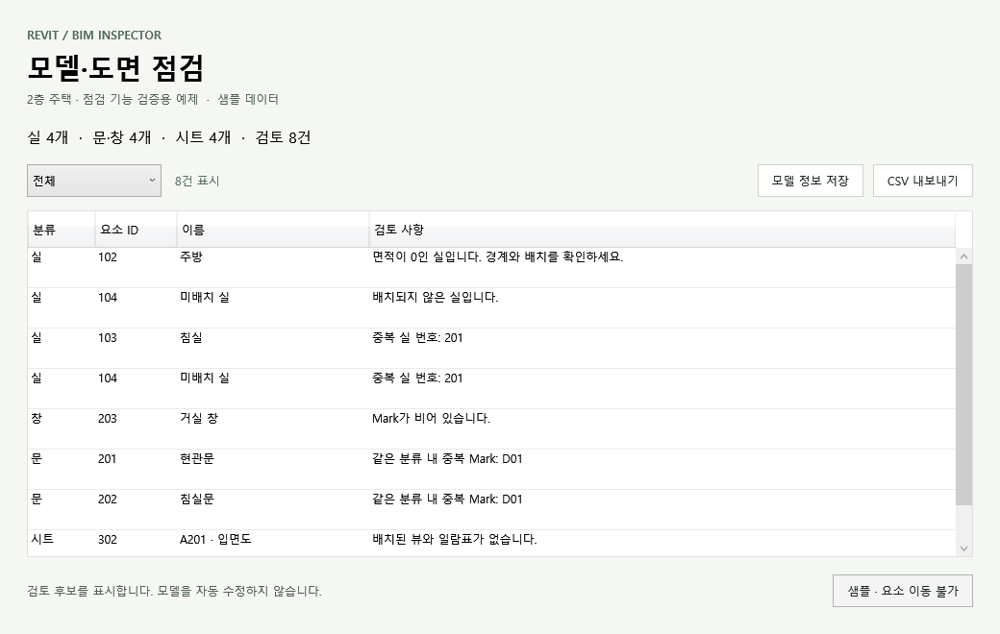

# Revit BIM Inspector

Revit 프로젝트의 실·문·창·시트 정보를 점검하고 CSV 보고서를 만드는 C# 도구입니다.
Revit 외부 명령과 WPF 화면, 점검 엔진, 독립 실행 가능한 샘플 프로그램으로 구성했습니다.

## 구현 기능

- 미배치 실과 면적 0인 실, 중복 실 번호 확인
- 문·창의 빈 Mark와 같은 분류 내 중복 Mark 확인
- 배치된 뷰·일람표가 없는 시트 확인: 예정 시트와 일람표 전용 시트는 제외
- 분류별 필터와 검토 목록 표시
- Excel용 UTF-8 CSV와 모델 정보 JSON 내보내기
- Revit 명령에서 검토 요소 선택·위치 보기: 시트는 해당 뷰 열기, 미배치 실은 위치 없음 안내

검토 후보를 제시하며 모델을 자동 수정하지 않습니다. 번호·Mark 중복은 프로젝트의 단계나 작성 규칙에 따라 의도된 경우가 있으므로 사용자가 판단합니다.

## 실행과 검증 상태

| 항목 | 확인 결과 |
| --- | --- |
| Revit 2026 설치 DLL을 참조한 Release 빌드 | 경고 0개·오류 0개 |
| 점검 규칙·CSV·JSON·WPF 필터 | 13개 검사 통과 |
| 샘플 JSON 실행과 CSV 출력 | 검토 8건 생성 |
| 설치 스크립트 | 별도 시험 폴더에서 DLL 3개와 addin manifest 생성 확인 |
| 실제 Revit 안에서 모델 수집·요소 이동 | 아직 실행 검증하지 않음 |

아래 화면과 `samples/` 데이터는 기능 확인용 예제입니다. 실제 RVT 모델에서 얻은 결과나 완성된 주택 모델을 의미하지 않습니다. Revit 모델링 작업은 [작업 기록](docs/project-notes.md)에서 별도로 진행합니다.



## 빌드

Windows, .NET 8 SDK, Revit 2026이 필요합니다. Autodesk DLL은 저장소나 배포 폴더에 포함하지 않습니다.
Revit API는 호스트가 제공하는 외부 참조로 지정했습니다.

```powershell
dotnet build BimInspector.sln -c Release
dotnet run --project tests/BimInspector.Checks -c Release
```

Revit 설치 경로가 다르면 다음과 같이 지정합니다.

```powershell
dotnet build BimInspector.sln -c Release -p:RevitInstallDir="D:\Autodesk\Revit 2026"
```

Revit 설치 없이 점검 엔진과 화면을 확인하려면 Demo 프로젝트만 실행합니다.

```powershell
dotnet run --project src/BimInspector.Demo -c Release
dotnet run --project src/BimInspector.Demo -c Release -- --export exports/reports
```

Revit 명령에서 저장한 JSON을 Demo에 다시 읽힐 수도 있습니다.

```powershell
dotnet run --project src/BimInspector.Demo -c Release -- --input model-snapshot.json
```

## Revit에 설치

Revit을 종료한 상태에서 Release 빌드 후 실행합니다.

```powershell
powershell -ExecutionPolicy Bypass -File scripts/install-addin.ps1
```

현재 사용자의 Revit 2026 Addins 폴더에 DLL과 manifest를 복사합니다.
Revit에서 프로젝트를 열고 **애드인 → 외부 도구 → BIM Inspector**를 실행합니다.
실제 모델 수집·요소 이동은 해당 환경에서 최종 확인해야 합니다.

## 구조와 구현 근거

| 경로 | 역할 |
| --- | --- |
| `src/BimInspector.Core/` | Revit에 의존하지 않는 점검 규칙·CSV·JSON |
| `src/BimInspector.UI/` | Revit과 Demo가 공유하는 WPF 화면 |
| `src/BimInspector.Addin/` | 읽기 전용 Revit 외부 명령과 모델 정보 수집 |
| `src/BimInspector.Demo/` | JSON 기반 실행·보고서 생성·화면 캡처 |
| `tests/BimInspector.Checks/` | 규칙·파일 출력·실제 WPF 필터 검증 |
| `samples/` | 검증용 데이터와 실제 실행한 CSV 결과 |

기능별 소스와 검증 범위는 [구현 근거](docs/feature-evidence.md)에 정리했습니다.

API 기준은 [Autodesk 개발 요구 사항](https://help.autodesk.com/cloudhelp/2026/ENU/Revit-API/files/Revit_API_Developers_Guide/Introduction/Getting_Started/Welcome_to_the_Revit_Platform_API/Revit_API_Revit_API_Developers_Guide_Introduction_Getting_Started_Welcome_to_the_Revit_Platform_API_Development_Requirements_html.html)과 [시트 배치 뷰 API](https://help.autodesk.com/cloudhelp/2026/ENU/Revit-API-MainReference/files/html/816db942-4e9c-7278-7f59-53048becc46a.htm)를 참고했습니다.

## 관련 프로젝트

- [건축 설계·CAD 포트폴리오](https://github.com/youns1998/portfolioCAD)
- [AutoCAD 생산성 도구](https://github.com/youns1998/cad-productivity-palette)
- [Python 도면 파일 정리 도구](https://github.com/youns1998/drawing-file-organizer)
